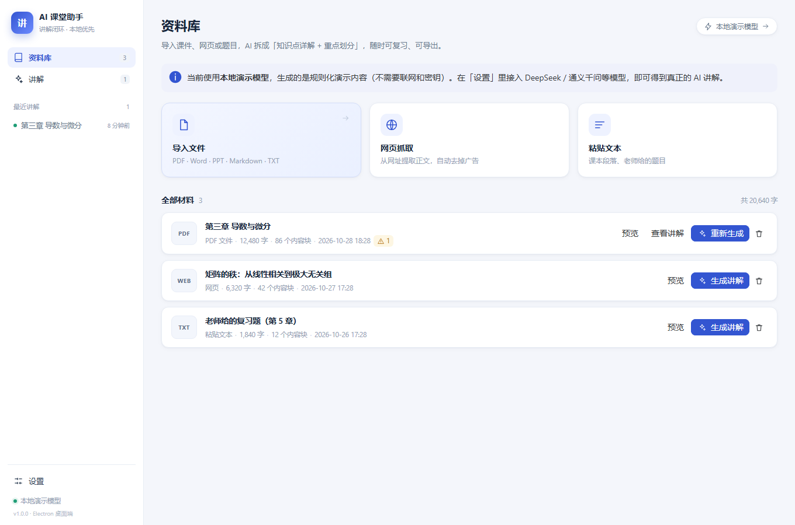
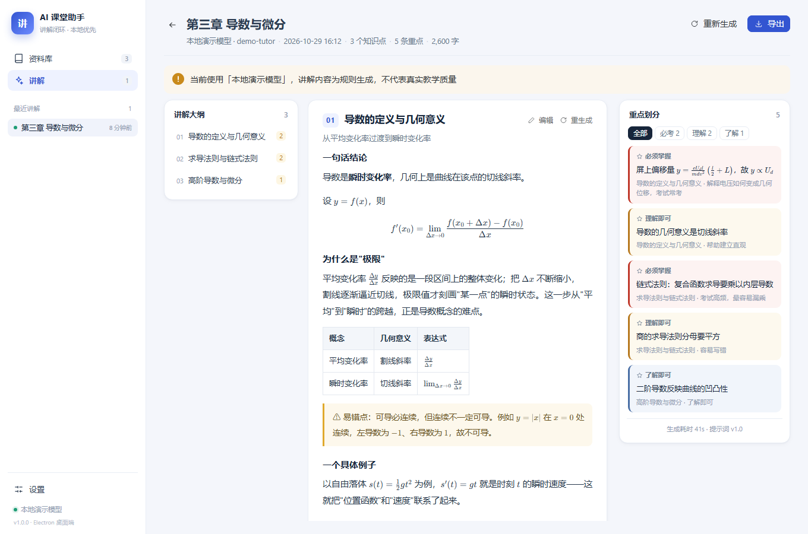
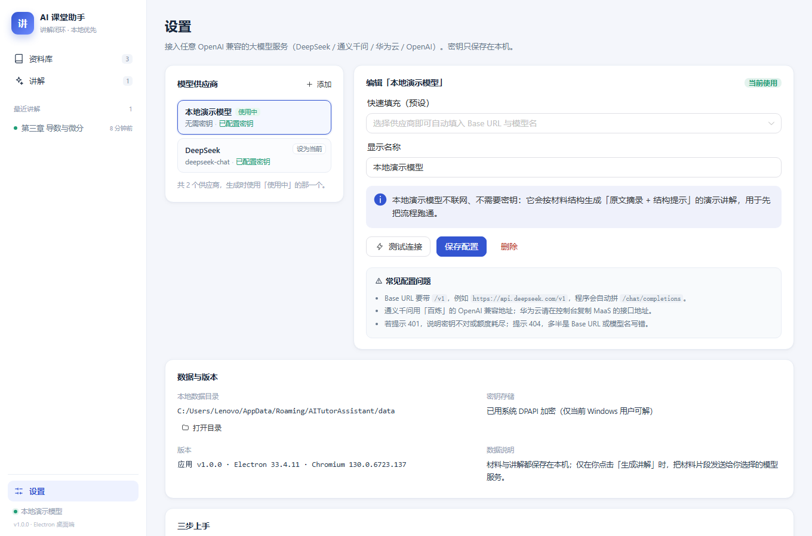

# AI 课堂助手（AI Teaching Assistant）

> 面向大学生自学的 AI 教学辅助桌面应用 —— **讲解闭环 MVP**
> 导入课件 → AI 生成「知识点详解 + 重点划分」→ 展示 / 编辑 / 导出（Word / PPT / PDF / Markdown）

依据设计文档：`2026-10-28-ai-teaching-assistant-design.md`（子项目 1）



---

## 1. 这是什么

一个可离线安装的 Windows 桌面应用。学生导入 PDF / Word / PPT / Markdown / 纯文本 / 网页正文，应用会：

1. **拆解大纲**：把材料拆成 5–8 个按认知顺序排列的知识点（概念 → 条件 → 公式 → 应用 → 易错点）；
2. **逐节讲解**（流式输出）：每节 400–700 字，含定义、原因、LaTeX 公式、具体例子、「⚠ 易错点」；
3. **划重点**：把全篇要点分成 **必须掌握 / 理解即可 / 了解即可** 三档，并说明「为什么重要」；
4. **展示与导出**：右侧常驻重点清单，支持导出 Word / PowerPoint / PDF / Markdown，也可现场手动编辑某一节后重新导出。

所有材料、讲解、密钥都只保存在本机；只有点击「生成讲解」时，才把材料片段发送给你自己配置的模型服务。



---

## 2. 安装与运行

### 2.1 下载现成的安装包

到 **[Releases](../../releases/latest)** 页面下载（对应 `v1.0.0`）：

| 产物 | 文件名 | 说明 |
| --- | --- | --- |
| **解压即用（推荐）** | `AI-Tutor-Assistant-1.0.0-win64.zip` | 解压后双击 `AI-Tutor-Assistant.exe`，不经过任何安装器 / 自解压层 |
| 免安装单文件 | `AI-Tutor-Assistant-1.0.0-portable.exe` | 双击即用，首次启动稍慢（NSIS 自解压层，可能被杀软拦截） |
| 安装版 | `AI-Tutor-Assistant-1.0.0-setup.exe` | 可选安装目录、创建桌面快捷方式 |
| 手机版（PWA） | `AI-Tutor-Assistant-mobile-web.zip` | 解压后双击「启动手机版.bat」，手机同 Wi-Fi 打开地址并「添加到主屏幕」 |

> 未做代码签名，Windows SmartScreen 可能提示「未知发布者」→ 点「更多信息 → 仍要运行」。

**⚠ 不要把程序放在桌面 / 文档 / 图片 / 下载目录里运行**：部分安全软件（如火绒的防勒索）会给这些目录加 `拒绝删除子项` 的 ACL，Chromium 初始化会直接崩在 `0x80000003`（连 JS 都没开始跑）。请解压到 `C:\AI-Tutor-Assistant`、`D:\AI-Tutor-Assistant` 或 `%LOCALAPPDATA%\Programs` 下。

**启动失败排查**：ZIP 里带了一键工具 —— `兼容模式启动.bat`（关闭 GPU 加速启动）、`诊断.bat`（生成 `诊断日志.txt`）。
程序自身也会写两份日志：`%APPDATA%\AITutorAssistant\boot.log`（代码是否被加载）与 `startup.log`（启动到哪一步、界面是否加载成功）。
窗口改为创建即显示，界面加载失败会直接显示错误页而不是白屏。

### 2.2 手机版（PWA）

同一个界面搬到浏览器：导入 PDF / Word / TXT / MD、生成讲解与重点、做习题、PDF 识图转写都能用；
**网页抓取、附件下载、Word/PPT/PDF 导出**需要电脑版。

- 解压 `AI-Tutor-Assistant-mobile-web.zip` → 双击 **启动手机版.bat**；
- 手机连同一 Wi-Fi，浏览器打开窗口里打印的地址（如 `http://192.168.x.x:8899/`）；
- 浏览器菜单 → **添加到主屏幕**，之后像 App 一样点开；
- 存储走浏览器 IndexedDB，AI 请求由手机直接发往你配置的服务（DeepSeek / 通义均支持跨域）。

细节见 [`docs/手机版使用说明.md`](docs/手机版使用说明.md)。

### 2.3 首次使用（建议顺序）

1. 打开应用 → 左下角 **设置**；
2. **模型供应商** → 点「添加」或直接选中已有供应商；
3. 选择预设（DeepSeek / 通义千问 / 华为云 MaaS / OpenAI），填入 **API Key**；
4. 点 **测试连接**，看到「连接成功」后点 **保存配置**（会自动设为当前使用）；
5. 回到 **资料库** → 导入文件 / 网页抓取 / 粘贴文本；
6. 在材料上点 **生成讲解**，等待 1–3 分钟；
7. 右上角 **导出** 选择 Word / PPT / PDF / Markdown。

不想先配置密钥也可以：默认的「**本地演示模型**」不需要联网，会用材料里的标题与原文规则化生成一份演示讲解，用来先把整个流程跑通（演示内容不代表真实教学质量）。



### 2.4 数据与密钥

| 内容 | 位置 |
| --- | --- |
| 材料、讲解、设置 | `%APPDATA%\AITutorAssistant\data\` |
| 密钥（DPAPI 加密） | `%APPDATA%\AITutorAssistant\secrets.json` |

密钥用 Electron `safeStorage`（Windows 下即 DPAPI）加密，只有当前 Windows 用户能解密；应用界面永远不会回显完整密钥。

---

## 3. 功能清单（本期已实现）

- [x] 文件导入：PDF（文本层）、DOCX、PPTX、TXT / MD / CSV / JSON / HTML
- [x] **PDF 识图导入**：pdf.js 把每页画到 canvas → 视觉模型逐页转写为 Markdown + LaTeX（公式保真，支持扫描页）
- [x] 网页抓取：两种模式 —— 公开页面用隐藏窗口直抓；需登录/翻页的页面打开**真实浏览窗口**（登录态持久化，独立分区）
- [x] **抓取页面附件**：自动识别页面里的 PDF / PPT / Word / ZIP 链接，用登录态下载后逐个解析导入
- [x] 手动粘贴文本 / 题目
- [x] 长文档分块 + 映射归并（先逐块提炼要点，再出大纲，避免超出上下文）
- [x] 结构化输出 + JSON Schema（`zod`）校验，失败带修正提示自动重试一次，再失败降级
- [x] 流式生成：逐节边生成边显示，可随时取消并保留已完成部分
- [x] 讲解产物可编辑（单节编辑 / 单节重新生成 / 整篇重新生成）
- [x] 重点划分三档（高/中/低）+ 按等级筛选 + 手动修改（IPC 已支持）
- [x] **习题练习**：按材料出题 / 整理现成题目（自动补解析）/ 手写题目；题干-选项-答案-逐步解析全支持 LaTeX；答案默认收起，不强制作答
- [x] **专注番茄钟（v2）**：自定义时长与预设、专注/短休/长休流转、可关联材料或题集、结算写入学习时间轴并统计连续天数
- [x] **错题本（v2）**：练习页一键收题、手动录入、按知识点/状态筛选、重练并更新掌握状态
- [x] **迷你窗口（v2）**：番茄钟可缩成 340×210 置顶小窗，边学边干别的
- [x] **日历（v2）**：月视图热力图 + 日程 CRUD + ICS 导入导出 + 首页最近提醒
- [x] **作业规划（v2）**：一次录入周期规则，每周自动生成布置/截止提醒
- [x] **课表（v2）**：登录教务系统抓取（接口 JSON + 页面表格双策略）/ 手动录入 / CSV 导入
- [x] **学习时间轴（v2 底座）**：`StudyEvent` 统一记录专注/练习/复习，首页卡片显示今日进度 + 每日励志语录
- [x] 导出 docx / pptx / pdf / md；PDF 用 Electron `printToPDF`，公式以 KaTeX MathML 渲染
- [x] 多供应商（OpenAI 兼容协议）、连接测试、指数退避重试、友好错误提示
- [x] 本地演示模型（无需密钥，离线可用）
- [x] 生成中途退出可恢复：已完成小节已落库，界面显示「部分完成」

---

## 4. 工程结构

```
ai-teaching-assistant/
├─ apps/desktop/
│  ├─ src/main/                 Electron 主进程
│  │   ├─ index.ts              窗口 / 菜单 / 生命周期
│  │   ├─ ipc.ts                全部 IPC handler（资料库、讲解、设置、导出）
│  │   ├─ secrets.ts            safeStorage 密钥存储
│  │   ├─ web-fetch.ts          网页正文抓取
│  │   ├─ pdf.ts                HTML → PDF（printToPDF）
│  │   └─ smoke.ts              自动化冒烟脚本（AITUTOR_SMOKE=1 时启用）
│  ├─ src/preload/index.ts      contextBridge 暴露 window.tutor
│  └─ src/renderer/             Vue 3 + Naive UI
│      ├─ views/LibraryView.vue  资料库（导入 / 预览 / 生成入口）
│      ├─ views/LessonView.vue   讲解（大纲 / 正文流式 / 重点 / 编辑 / 导出）
│      ├─ views/SettingsView.vue 模型配置与数据信息
│      └─ store.ts               前端状态与 IPC 事件订阅
├─ packages/                    —— 对应设计文档第 4 节的包边界
│  ├─ shared/                   共享类型（Document / LessonArtifact / IPC 契约）
│  ├─ content-ingest/           文件/网页/文本 → Document（含 PDF、DOCX、PPTX 解析）
│  ├─ ai-core/                  OpenAI 兼容网关（流式、重试、错误映射）
│  ├─ pedagogy/                 提示词编排：大纲 / 逐节详解 / 划重点（含降级与演示模型）
│  ├─ resource-service/         资源存取接口 + 本地 JSON 实现（为云端实现预留）
│  └─ export/                   docx / pptx / pdf / md 导出
├─ scripts/                     构建、图标、预览、冒烟脚本
├─ build/                       icon.ico / icon.png
└─ release/                     打包产物
```

### 关键设计取舍（与设计文档的差异）

| 设计文档 | 本实现 | 原因 |
| --- | --- | --- |
| 主进程内 Fastify（localhost）+ IPC/HTTP | **纯 IPC** | MVP 无跨进程消费者，IPC 更少故障面；`content-ingest`/`ai-core`/`pedagogy` 与传输层解耦，后续可无痛加 HTTP 层 |
| SQLite（better-sqlite3） | **JSON 原子写入**（`resource-service` 内部私有实现） | 避免原生模块在 Electron 下的重编译/ABI 问题；对外仍是 `ResourceService` 接口，替换为 SQLite/云端的改动只在一个文件内 |
| PPTX 解析库 | **自研轻量解析**（adm-zip + OOXML 文本抽取） | 少一个重量级依赖，够 MVP 读文字 |
| 导出公式 | Word/PPT 里公式转**线性文本**（`latexToPlain`），PDF 里用 **KaTeX MathML** | docx/pptx 无原生公式渲染；PDF 走 Chromium 可完整渲染 |
| 前端 ESM 产物 | **单文件 IIFE + `defer`** | Electron 用 `file://` 载入页面，ESM/CSS + `crossorigin` 会被 CORS 拦截（已实测） |

为子项目 2/3 预留的接口：`ResourceService`（云端实现）、`knowledge-base`（未建包，`Document.blocks` + `chunkBlocks` 已具备检索分块基础）、`pedagogy` 中 `generateLesson` 的 `maxSections`/`useChunkSummary` 参数（出题/问答可复用同一管线的分块与提示词基座）。

---

## 5. 开发

```bash
pnpm install                # 依赖（已配置 npmmirror / 华为云镜像，见 .npmrc）
pnpm run build              # 构建主进程 + 渲染层（含 index.html 后处理）
pnpm run typecheck          # tsc 检查 packages + 主进程
pnpm start                  # 本地运行 Electron（需可用的桌面会话）
pnpm run pack:portable      # 打免安装 exe
pnpm run pack:nsis          # 打安装包
```

自测脚本（无需图形界面）：

```bash
pnpm run smoke:backend      # 桩掉 electron，跑通 导入→生成→编辑→导出→删除 全链路
pnpm run smoke:export       # docx / pptx / pdf(HTML) / md 产物离线检查
pnpm run preview            # 生成 out/renderer/preview.html（假数据），可用浏览器打开检查 UI
```

Electron 发行包已经缓存于 `node_modules/electron/dist`，打包时通过 `electronDist` 复用，不会重复下载。
如果换机器后 `pnpm install` 卡在 Electron 下载（GitHub 不可达），可执行：

```powershell
powershell -ExecutionPolicy Bypass -File scripts/fetch-electron.ps1
```

脚本会从华为云镜像下载 Electron 33.4.11、校验官方 SHA256、解压到 `node_modules/electron/dist`。

---

## 6. 已验证 / 未验证

**已验证（在目标机器上真实运行）**

- 应用从 `C:\AI-Tutor-Assistant` 启动后**窗口正常出现**，`startup.log` 完整走完
  `app ready → ipc handlers registered → creating window → did-finish-load → renderer loadFile resolved`，界面截图正常
- `tsc` 类型检查通过（packages + 主进程）
- 后端链路（桩 Electron + 真实业务代码）：23 个 IPC 通道、文本导入、演示模型生成、流式事件、单节编辑、docx/pptx/pdf/md 导出、级联删除
- 渲染层在真实 Chromium（Edge）以 `file://` 加载构建产物：三页 UI、KaTeX 公式、表格、重点分级均正常
- 导出产物用 LibreOffice 打开并逐页渲染检查：Word 封面/正文、PPT 章节页与重点页版式正常

**启动崩溃的根因（已定位并规避，重要）**

- 现象：双击后"转圈一会儿没有窗口"，退出码 `0x80000003`（STATUS_BREAKPOINT），无日志、无崩溃记录
- 原因：**程序所在目录被防勒索保护**（桌面 / 文档 / 图片 / 下载），ACL 中含 `Everyone: 拒绝 DeleteSubdirectoriesAndFiles`；
  Electron(Chromium) 在这些目录下启动会在初始化阶段直接断言失败
- 证据：同一份程序放 `C:\` 正常、放桌面即崩；把本机正常运行的 DeepSeek Harness 整个复制到桌面也无法启动
- 规避：安装到非受保护目录（如 `C:\AI-Tutor-Assistant` 或 `%LOCALAPPDATA%\Programs`），或在安全软件里把该目录加入白名单
- 兼容性：Electron 33 / 39 / 44 从 `C:\` 均可正常启动，最终产物统一使用 **Electron 44**（与本机已正常运行的 DeepSeek Harness 同代）

---

## 7. 已知限制（MVP）

- 扫描版 PDF（无文本层）无法解析，需粘贴文本；
- PDF 中的公式/图表只能拿到文本层近似内容；
- Word/PPT 导出里公式为线性文本（如 `f'(x₀)=lim(Δx→0)(f(x₀+Δx)-f(x₀))/Δx`），PDF 导出才是排版后的公式；
- PPT 只输出最多 6 个知识点页（避免几十页 PPT），完整内容看 Word/PDF；
- 单次生成上限 9 个知识点；超长文档只对前 8 个分块做摘要；
- 未实现出题、问答（子项目 3）与账号/云端同步（子项目 2）。

---

## 8. 后续路线

1. **子项目 3 优先**：练习闭环（出题→作答→批改讲评）可复用 `pedagogy` 的分块与结构化校验；问答闭环需要 `knowledge-base`（sqlite-vec + embedding）。
2. **子项目 2**：把 `resource-service` 的本地实现换成云端实现，界面与教学逻辑不动。
3. 体验增强：导出模板（PPT 版式 / Word 样式）、深色模式、快捷键、批量导入。

---

## 9. 许可

内部 MVP 代码，仅供学习与研究使用。生成的讲解内容仅供自学参考，请以教材与老师讲解为准。
